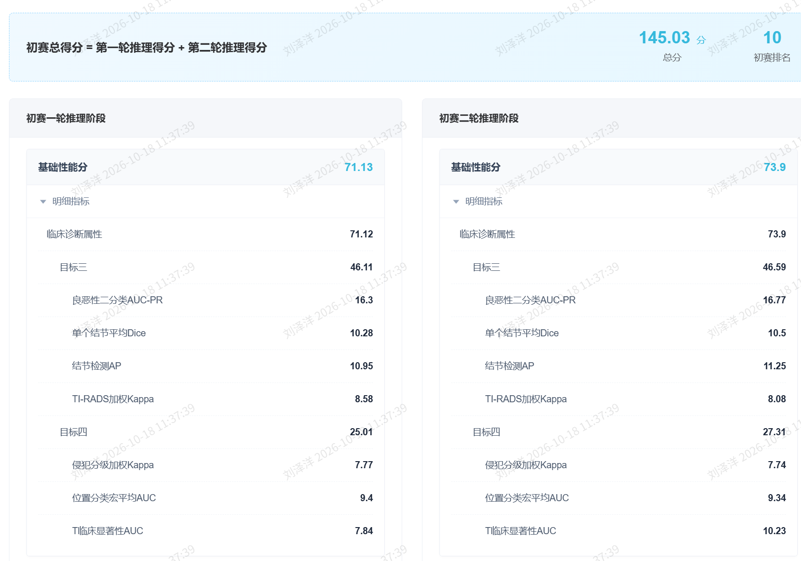

# 甲状腺超声多任务智能诊断系统

2026 全国医保影像 AI 识图大赛 · 赛道七（基于超声的甲状腺癌智能检测）· 自有模型组 · 团队「南师智医」

一个面向甲状腺超声影像的多任务智能诊断系统：在单一常驻 HTTP 推理服务中同时完成**结节分割与检测、良恶性判别、TI-RADS 分级、甲状腺外侵犯（ETE）分级、病灶位置（7 类）分类、T 临床显著性判别**，覆盖静态 DICOM 切片与动态 3D NIfTI 视频序列两类输入。

## 🏆 初赛成绩

**总分 145.03 / 初赛排名全国第 10**（两轮推理得分之和，提交于 2026-09-26）——全程**仅用官方提供的训练数据、自有模型组**（无额外数据增援、无预训练大模型微调），从零训练到线上部署全链交付。



| 指标 | 一轮 | 二轮 |
|---|---|---|
| 基础性能分 / 临床诊断属性 | 71.13 / 71.12 | 73.9 / 73.9 |
| 目标三（检出肿瘤/非肿瘤，60%） | 46.11 | 46.59 |
| 单结节平均 Dice | 10.28 | 10.5 |
| 结节检测 AP | 10.95 | 11.25 |
| 良恶性二分类 AUC-PR | 16.3 | 16.77 |
| TI-RADS 加权 Kappa | 8.58 | 8.08 |
| 目标四（恶性结节分期，40%） | 25.01 | 27.31 |
| 侵犯分级（ETE）加权 Kappa | 7.77 | 7.74 |
| 位置分类宏平均 AUC | 9.4 | 9.34 |
| T 临床显著性 AUC | 7.84 | 10.23 |

## 系统架构

- **双骨干**：分类侧 EfficientNet-B2 + 分割侧 ConvNeXt-Nano（均 ImageNet 预训练）+ U 形分割解码器 + CBM 概念瓶颈层 + 五个轻量分类头
- **核心创新——union 监督**：同图全部 GT 病灶掩码并集作分割监督，直接对齐官方 IoU 匹配口径（离线判线 +2.2pt 匹配率），是最终交付权重的主引擎
- **分割损失**：BCE + Dice + Lovász-Hinge（Berman 2018 二值形式，直接优化 IoU 口径）
- **A/B/C 调度训练**：冻分类骨干温升 → LLRD 分层解冻 → 低 lr 收尾；分割前向链全程可训
- **部署形态**：容器化常驻 HTTP 服务（uvicorn:8000，批量目录任务 + 健康探针），逐病例输出 `prediction.json` + 逐结节 `.nii.gz`

## 工程亮点

- **零分防线工程**：概率分布完备性、置信度值域硬校验（防 NaN 静默垫底）、动态 3D 掩码全帧契约、预测目录白名单——十次线上测评，后五次零格式判零
- **实验纪律**：预注册判死线 + 环境一致性哨兵对照（同权重重复测量 Δ=±0.0000），每轮换权重决策有据可归因
- **测试防线**：1500+ 测试（含变异杀测、镜像契约注入），CI 双门（import 契约 + 真实 docker build 冒烟）

## 仓库结构

```
src/
├── models/       # 双骨干多任务模型 + 损失(含 Lovász-Hinge/union 监督)
├── training/     # A/B/C 调度、ROI 指标链、验证指标
├── dataset/      # 官方数据 loader(动态帧预抽取缓存)
├── inference/    # 推理管线(静动分发/后处理/V2.1 输出契约)
├── gatekeeper/   # 真实性/去重/篡改四层门控
└── service/      # 常驻 HTTP 推理服务
scripts/          # 训练/验证/诊断工具
tests/            # 1500+ 测试套件
docs/             # 项目文档(评分口径/数据格式/架构记录)
```

## 环境与运行

```bash
pip install -r requirements.txt          # 推理
pip install -r requirements-train.txt    # 训练额外依赖
python scripts/verify_model.py           # Gate1 八门验证
pytest tests/ -v                         # 全量测试
```

训练与推理均在官方云容器（PyTorch 2.8 + CUDA 12.8）执行；单卡 32GB 显存内完成（训练峰值 <9GB）。

## License

MIT
