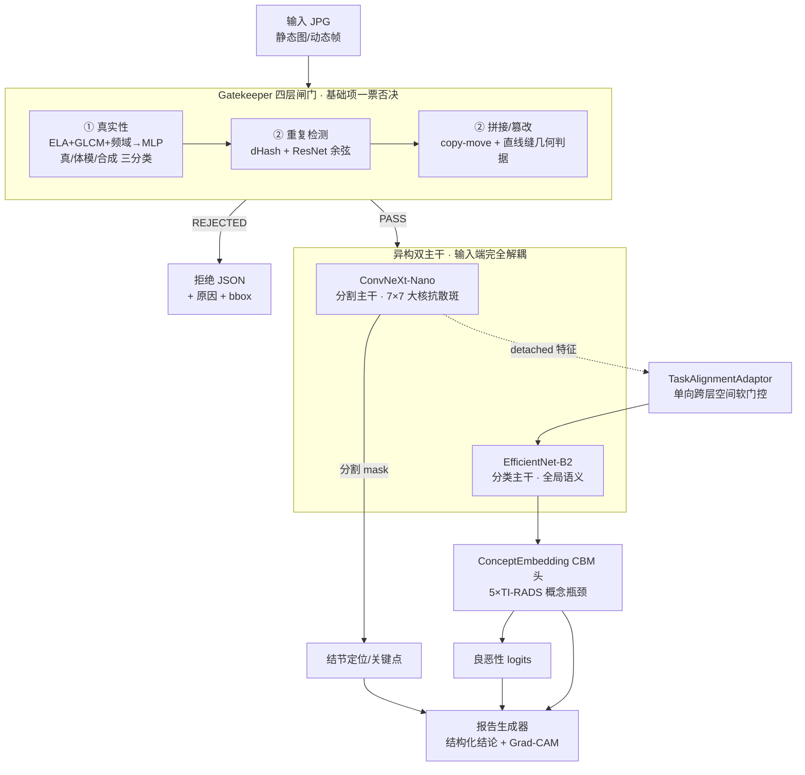

# 技术报告(初赛) — 基于超声的甲状腺癌智能检测

> 赛道七 · 自有模型组 · 全国医保影像AI识图大赛 2026
> **本文件为骨架**:`[待数据]` = 需官方数据到位后填;`[TODO]` = 现可补写。
> 撰写对齐初赛评审两条线:**自动化评分(推理性能 + 效率)** + **专家评审(创新性 / 可靠性 / 合理性 / 独特性 + 数据异质性 / 真实世界复杂性 / 可扩展性)**。

---

## 0. 摘要 `[TODO]`

一段话讲清:我们为赛道七构建了一套**离线、可解释、覆盖五项能力**的甲状腺超声多任务诊断系统;核心创新是 **异构双主干解耦 + 单向跨层任务对齐 + 概念瓶颈(CBM)可解释报告 + 四层 gatekeeper 真实性/规范性闸门**;在保证 `[待数据]` 推理时延 < 2s 的前提下兼顾精度与可解释性。

---

## 1. 赛题理解与五项能力对齐

| 赛题能力项 | 性质 | 我们的模块 | 报告章节 |
|:---|:---|:---|:---|
| ① 真实性(真/假/非人体) | **基础·一票否决** | `gatekeeper/authenticity.py` | §4.1 |
| ② 规范性(重复/拼接) | **基础·一票否决** | `gatekeeper/{deduplication,tampering}.py` | §4.2 |
| ③ 病灶识别(肿瘤 vs 非肿瘤) | 核心 | 分割 + 良恶性分类头 | §5.1 |
| ④ 辅助诊断(分期/疾病分析) | 核心 | CBM 概念头(5×TI-RADS) | §5.2 |
| ⑤ 判读效率(关键点+可解释) | 加分(决赛重点) | 分割 mask + CBM 结构化报告 | §5.3 |

**战略判断**:①②是入场券,不达标直接出局,故报告**优先详述基础项的鲁棒性**;③④⑤体现核心算法与可解释性深度。

---

## 2. 系统总体架构

总体数据流如下(离线单容器内完成):

文字描述:输入(JPG 静态/动态帧)→ **gatekeeper 四层闸门**(真实性→重复→拼接/篡改)→ 通过后进入 **双主干**(ConvNeXt-Nano 分割 + EfficientNet-B2 分类)→ **TaskAlignmentAdaptor** 单向跨层空间对齐 → **CBM 概念头**输出 5 维 TI-RADS 概念 + 良恶性 → **报告生成器**输出可解释结论 + Grad-CAM。

- 关键设计原则:**完全解耦双主干**消除分割/分类的表征竞争(详见 §5.1 论证);任务对齐**单向**(分割→分类,且分割特征 `detach`),防止分类梯度回流污染分割主干。
- 部署形态:离线推理容器(`predict.py` 单图 + `video_predict.py` 动态图,`entrypoint.sh` 按输入扩展名自动分发并对两入口 + `best_model.pth` 做 SHA-256 校验),无外网依赖,契合"比赛期间不联网"约束。

---

## 3. 数据与预处理 `[待数据]`

- 官方数据形态(到位后填):图像级/像素级/bbox 标注粒度、良恶性金标准、是否带 TI-RADS 概念标注、静态/动态帧处理。
- 现阶段预演数据:TN3K(分割 Dice ≈ 0.98),良恶性标签缺失,分类为架构预演。
- 预处理:灰度归一化(`img/255`,训练-推理一致)、DICOM/元数据脱敏(21 字段 HIPAA Safe Harbor)。
- 划分:纯随机图像级 train/val + 物理隔离 holdout,gate5 双向重叠校验(防泄漏)。

---

## 4. 基础考核项(一票否决,重点)

### 4.1 真实性识别:真人体 / 假人体 / 非人体
- 方法:`authenticity.py` 传统CV(ELA + GLCM + 频域)特征 + MLP 分类。
- 合成数据引擎:`gatekeeper/synthesis.py` 生成假/非人体样本用于训练(等官方真假样本到位后微调/校准)。
- `[待数据]` 官方真假标注 → 升级/验证为达标方案;报告需给出三分类指标与失败样本分析。

### 4.2 规范性审核:重复 / 拼接
- 重复检测:`deduplication.py` 特征哈希(dHash)+ ResNet 余弦近重复召回(二级兜底)。
- 拼接/篡改:`tampering.py`。**copy-move** 用稠密块匹配(特征 = 块均值/标准差 + 4×4 降采样,空间隔离 + 簇过滤,干净图零误报);**splicing** 经两轮迭代后定为**几何缝判据**——放弃像素/区域方差方案(超声结节本身即局部方差异常区,实测干净图 20/20 误报,触碰一票否决红线),改抓硬粘贴矩形特有的「轴对齐长直缝 + 角点正交相交」特征。实测干净图误报 **0/80**(红线达标),真实组织拼接召回 **~84%**。
- `[待数据]` 官方重复/拼接标注 → 标定阈值、补召回/误报曲线。

---

## 5. 核心算法

### 5.1 病灶识别:异构双主干 + 任务对齐
- **问题**:单主干晚期分叉导致分割(密集预测,要空间细节)与分类(全局语义)的**梯度角度冲突**,锁死 AUC。
- **方案**:输入端即解耦 ConvNeXt-Nano(分割,7×7 大核抗散斑)+ EfficientNet-B2(分类);**TaskAlignmentAdaptor** 用 detached 分割特征作软注意力门控,单向注入分类分支(Stage3/4)。
- 论据见 `reference/…完全解耦非对称双主干…调研报告.md`(数学推导 + 选型对比)。
- `[待数据]` 良恶性 AUC、分割 Dice(校准后真实基准)。

### 5.2 辅助诊断:概念瓶颈(CBM)
- 5 维 ACR TI-RADS 概念(composition/echogenicity/shape/margin/foci)经概念瓶颈预测,再聚合到良恶性 → **可解释、可干预**。
- 当前概念为 mask 形态学弱监督伪标签;`[待数据]` 若官方带 TI-RADS 概念标注则转监督训练。

### 5.3 判读效率:关键点 + 可解释报告
- 分割 mask → 结节定位/关键点;CBM 概念 + Grad-CAM(双主干分支)→ 结构化诊断报告。
- Grad-CAM 已接入 `predict.py --enable_gradcam`:对 `cls_backbone`(EfficientNet-B2)末层求恶性激活热图,叠加原图输出 `gradcam_cls.png`,`result.json` 置 `gradcam_generated:1`。端到端梯度路径有回归测试守卫。
- 这是决赛重点(临床价值与可解释性),报告应展示样例输出。`[TODO]` 放报告样例图(等真权重推理产出)。

---

## 6. 训练方法与正确性保障

- **三阶段渐进训练**:Stage1 分割+概念预热 → Stage2 全量 → Stage3 主干冻结、AUC 精调。
- **5 通道 FAMO** 动态损失加权(独立通道防梯度相消);**Masked 多任务损失**(缺标签样本零梯度污染,适配官方部分标注)。
- **续训态持久化**:`training_state.pth` 存 FAMO 权重 + AUCM 对偶参数 + lambda_latent,与 best_model 配对,支持中断恢复。
- **质量门**:`verify_model.py` 7-Gate(形状/梯度隔离/数值安全/优化器绑定/BatchNorm 冻结/Stage 掩码/LR 对齐)+ reviewer 审查 + 102 回归测试 → 体现"模型质量可靠性"。

---

## 7. 工程化与推理效率(自动化评分线)

- `[待数据]` 单图推理时延(目标 < 2s)、吞吐、显存占用(规划单卡 32G)。
- 自适应精度:`--precision fp32/fp16/bf16`,半精度对 malignancy clamp ±15 防溢出。
- 离线容器:`inference_mode` + autocast;`entrypoint.sh` 按输入扩展名自动分发到 `predict.py`(静态图)/ `video_predict.py`(cine),对 `best_model.pth`/`predict.py`/`video_predict.py` SHA-256 校验,`PRODUCTION=1` 哈希不符硬退出。

---

## 8. 数据异质性与真实世界鲁棒性(专家评审重点)

基层超声设备异构、增益不一、散斑噪声、声影伪影。我们以**超声物理先验**为指导设计 7 种领域专用增强(`dataset/augmentation/transforms.py`),而非套用自然图像 transform;ConvNeXt 7×7 大核本身亦是天然低通,对散斑稳健。

| 增强 | 物理对应 | 关键参数 | 概率 |
|:---|:---|:---|:---|
| RandomAffine | 探头位姿/视野变化 | ±15° 旋转 / ±10% 平移 / 0.95–1.05 缩放 | 0.5 |
| RandomElasticDeformation | 探头压力致软组织形变 | alpha=150, sigma=15(cv2.remap) | 0.3 |
| RandomSpeckleNoise | 乘性散斑/增益噪声 `I·(1+n)` | std 0.05–0.15 | 0.5 |
| DepthAttenuation | 深度方向声衰减 `exp(-μy)` | μ 0.1–0.4 | 0.3 |
| GaussianShadow | 钙化灶下方声影(沿结节向下) | 宽 10–30px,衰减 0.3–0.7 | 0.3 |
| HazeArtifact | 近场杂波/雾化(上强下弱) | 1/8 尺度噪声上采样 × 纵向梯度 | 0.2 |
| SpeckleReduction | 机内散斑抑制滤波 | 双边 d=5 | 0.2 |

- **Dominant-Region CutMix(DR-CutMix)**(`mixup.py`):粘贴区按**结节占比 R** 决定标签继承——`R≥0.65` 继承 donor 标签、`R≤0.35` 继承 recipient、中间区(0.35<R<0.65)`mask_weight=0` 屏蔽分类损失,避免歧义样本污染监督;无结节区同样置零。这是把 CutMix 适配到**像素级 + 分类多任务**的关键改造。
- 静态图 + 动态图(cine)两种输入均已支持:静态走 `predict.py`;动态走 `video_predict.py`——均匀抽帧(MP4/AVI/MOV/MKV + 多帧 DICOM cine,含彩色/多普勒灰度兜底)→ 逐帧 gatekeeper(一票否决,去重库一次播种跨帧复用)+ 逐帧诊断 → 帧级聚合(恶性概率取**最大帧**做最终判定,召回优先)→ 关键帧产出 mask/报告/Grad-CAM。具体抽帧数/聚合权重待官方动态数据形态确定后微调。
- 域偏移缓解、单类/缺标签鲁棒:**Masked 多任务损失**对缺标签样本零梯度,适配官方部分标注(详见 §6)。

---

## 9. 创新点总结

对照专家评审维度(创新性 / 可靠性 / 合理性 / 独特性 + 数据异质性 / 真实世界复杂性 / 可扩展性)逐条强化:

1. **异构非对称双主干 + 单向跨层任务对齐**(创新性 / 独特性):输入端即解耦 ConvNeXt-Nano(分割)与 EfficientNet-B2(分类),从根上消解多任务**梯度角度冲突**;TaskAlignmentAdaptor 以 detached 分割特征作软注意力**单向**门控注入分类分支,既借力空间先验又杜绝梯度回流污染。区别于常见"共享主干晚期分叉"的范式。
2. **概念瓶颈(CBM)可解释诊断**(合理性 / 临床价值):预测 5 维 ACR TI-RADS 概念(composition/echogenicity/shape/margin/foci)再聚合良恶性,诊断**可解释、可干预**——医生可修正概念层并观察结论变化,契合医保审核的可追溯诉求。
3. **四层 gatekeeper 把"真实性/规范性"工程化为可验证闸门**(可靠性 / 真实世界复杂性):真实性三分类 + 重复(dHash+ResNet)+ 几何缝拼接检测 + copy-move,且**以一票否决红线为最高约束**——splicing 检测器经两轮失败后主动放弃方差方案、换取干净图 0/80 零误报,体现"宁可漏检不可误杀真实影像"的医保场景工程取舍。
4. **缺标签鲁棒的训练栈**(数据异质性 / 可扩展性):5 通道 FAMO 动态损失加权 + Masked 多任务损失(缺标签零梯度)+ DR-CutMix 占比化标签继承,适配官方**部分标注 / 数据异质**;7 种超声物理先验增强提升设备域鲁棒。
5. **全离线、可校验、可恢复的生产级工程**(可靠性 / 可扩展性):SHA-256 双入口校验、续训态持久化(FAMO+AUCM 对偶参数)、`verify_model.py` 7-Gate + reviewer 审查 + 102 回归测试构成质量门;架构模块化(概念头可换、gatekeeper 可插拔),便于跨赛道复用。

---

## 10. 实验结果 `[待数据]`

- 校准后 Holdout:分割 Dice / 良恶性 AUC / TI-RADS F1 / 真实性三分类 / 规范性召回-误报。
- 消融:双主干 vs 单主干、有无任务对齐、有无 CBM、FAMO vs 固定权重。
- 推理效率表。

---

## 11. 落地与可扩展性 `[TODO]`

- 医保场景适配:基层可部署、离线、隐私合规(脱敏)。
- 可扩展:多赛道架构复用、概念头可换、gatekeeper 可插拔。

---

### 撰写清单(Checklist)
- [ ] §0 摘要(等核心指标出来后定稿)
- [x] §2 总架构图(mermaid 已补);§8 增强策略表(已补);§9 创新点对照评审维度(已补)
- [ ] §5.3 报告样例图(等推理产出后补)
- [ ] 所有 `[待数据]` 项:官方数据到位后填指标
